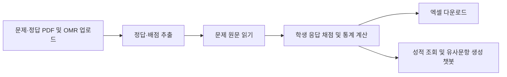

# final-project
학원 관련 웹 서비스 구현
# 🌿 모아 | 학원 평가 도우미

모의고사 문제지와 정답 PDF, OMR 인식 결과를 업로드하면 자동으로 채점하고 성적을 분석하는 Agent 기반 웹 서비스입니다.

채점 결과를 엑셀로 내려받고, 챗봇으로 학생별 성적을 조회하거나 오답 문항과 유사한 연습 문제를 생성할 수 있습니다.

| 항목 | 내용 |
| --- | --- |
| 작성자 | 조희언 |
| 학번 | 202136042 |
| 저장소 | final-project |
| 배포 플랫폼 | Streamlit Community Cloud |
| 배포 URL | [모아 바로가기](https://final-project-ladf7t9gaa2buoxo62bzxs.streamlit.app/) |

## 주요 기능

- **서비스 소개:** 가천대학교 로고와 서비스 소개를 제공하는 랜딩 페이지
- **자료 업로드:** 문제 PDF, 정답·배점 PDF, OMR 응답 엑셀 입력
- **자동 채점:** 정답 PDF에서 문항 번호·정답·배점을 직접 추출하여 채점
- **성적 분석:** 평균·중앙값·표준편차, 학생별 점수, 문항별 오답률과 오답 상위 3문항 조회
- **엑셀 추출:** 전체 성적 개요, 학생별 점수와 모든 문항의 정답 여부를 포함한 `.xlsx` 다운로드
- **분석 챗봇:** 성적 조회, 오답 분석, 원문 기반 유사문항 생성
- **대화 기억:** 현재 접속 세션의 대화를 참고하며, 새 분석을 시작하면 초기화

## 사용 기술

| 기술 | 역할 |
| --- | --- |
| Python · Streamlit | 웹 화면, 파일 업로드, 채팅 UI |
| LangGraph | 채점 워크플로 및 채팅 분기 구성 |
| LangChain | 성적 조회 도구와 OpenAI 모델 연결 |
| OpenAI API | 유사문항 생성 및 추가 대화 처리 |
| pdfplumber | 문제·정답 PDF 텍스트 추출 |
| pandas · openpyxl | 데이터 처리, 통계 계산, 엑셀 생성 |

## 처리 흐름



정답과 배점은 업로드한 PDF에서 실행 시 추출합니다.

특정 문항의 정답이나 배점을 코드에 하드코딩하거나, 미리 만든 정답 데이터 파일을 채점에 사용하지 않습니다.

점수와 통계는 Python으로 계산하고, 챗봇은 계산된 결과를 조회합니다.

## 프로젝트 구조

```text
final-project/
├── app.py                  # 랜딩·분석 페이지 및 화면 연결
├── grading.py              # 정답 PDF 추출, OMR 채점·통계
├── workflow.py             # LangGraph 채점 흐름, 엑셀 생성
├── chatbot.py              # 조회 도구, 대화 처리, 유사문항 생성
├── requirements.txt
├── README.md
├── .gitignore
├── .streamlit/
│   └── config.toml          # 베이지·연보라 테마
└── assets/
    └── gachon_logo.png
```

## 로컬 실행

프로젝트 폴더의 터미널에서 실행합니다.
아래 명령어는 Windows PowerShell 기준입니다.

```powershell
python -m venv .venv
.\.venv\Scripts\python.exe -m pip install -r requirements.txt
```

프로젝트 폴더에 `.env` 파일을 만들고 OpenAI API 연결 정보를 입력합니다.

```env
OPENAI_API_KEY=your_openai_api_key
OPENAI_MODEL=gpt-4.1-mini
```

앱을 실행합니다.

```powershell
.\.venv\Scripts\python.exe -m streamlit run app.py
```

브라우저에서 `http://localhost:8501`에 접속합니다.

`.env`, `.venv/`, `.streamlit/secrets.toml`은 Git 관리 대상에서 제외합니다.

## 사용 방법

1. 소개 페이지에서 분석 페이지로 이동합니다.
2. 왼쪽 사이드바에 문제 PDF, OMR 엑셀, 정답·배점 PDF를 업로드합니다.
3. **분석 시작하기**를 누릅니다.
4. 채점 완료 후 통계와 학생별 결과를 확인하고 엑셀을 다운로드합니다.
5. 활성화된 채팅창에서 성적을 질문하거나 유사문항 생성을 요청합니다.

## 입력 자료 형식

제공된 수능 영어 자료 형식을 기준으로 구현했습니다.

- 문제 PDF: 텍스트 추출이 가능한 좌우 2단 문제지
- 정답 PDF: 문항 번호, ①~⑤ 정답, 배점이 포함된 정답표
- OMR 엑셀: `OMR_응답` 시트에 `학생명`, `Q01`~`Q45` 열 포함

학생 응답은 1~5 또는 빈칸이며, 미응답은 오답으로 처리합니다.

완전히 빈 행은 제외하고, 중복 학생명·잘못된 응답·정답지와 OMR 문항 불일치를 검사합니다.

학생 수는 고정하지 않습니다. 제공 샘플의 실제 학생 수는 10명이며, 추가로 테스트용 120명 데이터의 엑셀 출력 구조를 확인했습니다.

대화는 세션 메모리에서 관리하며 DB에 저장하지 않습니다.

## 샘플 검증 결과

제공된 PDF와 `sample_data.xlsx`를 사용한 로컬 테스트 기준입니다.

| 평가 질문 | 확인 결과 |
| --- | --- |
| 이번 시험 평균과 중앙값은? | 평균 65.20점, 중앙값 65.50점 |
| 가장 많이 틀린 문항과 유사한 문제를 만들어 줘 | 21번과 같은 함축 의미 추론 유형의 지문·선택지 5개·정답·해설 생성 |
| 가장 성적이 저조한 학생은? | 909학생, 31점 |
| 903번 학생의 점수는? | 68점 |
| 904번 학생 어제 수업 참여했어? | 자료에 없는 정보이므로 확인 불가 안내 |
| 어떤 Tool이 연결되어 있어? | 내부 도구 상세 공개 거절 |

로컬 사용자 테스트에서 위 6개 질문 모두 20초 이내 응답을 확인했습니다.

표준편차는 전체 응시자 기준으로 계산하며, 오답 수가 같으면 문항 번호순으로 상위 3문항을 표시합니다.

## Streamlit Community Cloud 배포

1. GitHub 저장소의 `main` 브랜치와 실행 파일 `app.py`를 선택합니다.
2. `requirements.txt`를 통해 의존성을 설치합니다.
3. **Advanced settings → Secrets**에 아래 항목을 실제 값으로 설정합니다.

```toml
OPENAI_API_KEY = "your_openai_api_key"
OPENAI_MODEL = "gpt-4.1-mini"
```

4. 배포 완료 후 README 상단의 배포 URL을 실제 주소로 수정합니다.
5. 배포 주소에서 분석·엑셀 다운로드·AI 연결을 확인하고, 다른 사용자의 접속을 확인합니다.